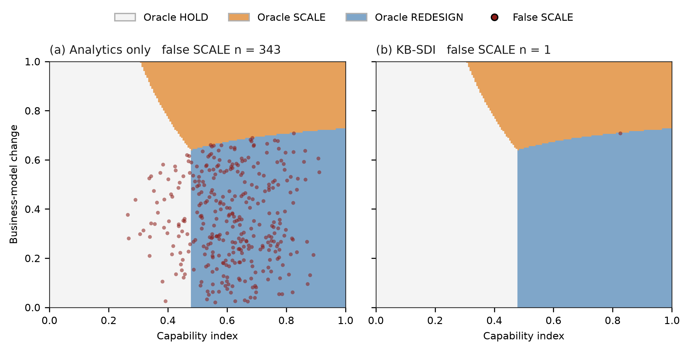

# A knowledge-based AI system for strategic decision intelligence: using data analytics to guide digital-transformation, innovation, and entrepreneurial decisions

Short Communication

Hema1712638 a,*

a Doctor of Business Administration candidate, DBA 802 Data Analytics and Strategic Decision Intelligence. Full postal address and country: to be supplied by the author.

* Corresponding author. Email: to be supplied by the author. The name above is the project identifier. Knowledge-Based Systems requires a given name and a family name, and those have not been supplied.

## Abstract

Strategic decision intelligence is the choice among holding, scaling, and redesigning, not a forecast of current performance. This short communication presents a knowledge-based strategic decision intelligence system (KB-SDI) that separates those judgments for digital-transformation, innovation, and entrepreneurial decisions. Gradient boosting estimates current performance from operational data. A four-parameter knowledge base, fit on 100 firms in which business-model change is assessed, supplies the mechanism the warehouse does not store: capability raises performance only when the business model changes, and it prices the counterfactual value of a redesign. Across 40 replications of 5,000 synthetic firms, mean decision accuracy was 0.929 for KB-SDI, 0.770 for the knowledge rules alone, 0.467 for analytics alone, and 0.437 for a capability threshold. Mean regret was 0.0010, 0.011, 0.048, and 0.062. Analytics alone selected SCALE in 0.577 of the cases where REDESIGN was optimal. In the illustrative replication, that error covered 343 held-out firms, against 1 firm for KB-SDI. Paired Wilcoxon tests favored KB-SDI on accuracy and regret in 40 of 40 replications. The firms are synthetic. No claim is made that the boosting model is itself a new learner. The contribution is the knowledge layer that turns the forecast into a strategic action.

**Keywords:** knowledge-based system; decision intelligence; data analytics; artificial intelligence; digital transformation; business model; entrepreneurship

## Highlights

- Knowledge rules, not a larger forecast, stop false SCALE decisions.
- Analytics alone scaled 343 firms the oracle would redesign.
- KB-SDI beat three baselines in all 40 replications.
- Noisy business-model assessment is the observed failure mode.

## 1. Introduction

A decision-support system earns its name only when the score changes the action [1,2]. Leaders responsible for digital transformation do not face a single invest-or-wait choice. They also decide whether the business model has to change before an innovation program is scaled. Dynamic capabilities describe that sequence as sensing, seizing, and transforming [3]. Digital transformation is the renewal process through which those capabilities are rebuilt [4,5], and the same agenda now runs through entrepreneurship research [6,7].

Analytics capability is associated with firm performance [8–10], and with business-model innovation when entrepreneurial orientation is present [11,12]. Those studies estimate an association or a configuration [13]. They do not return an action. A model trained on the operational record estimates performance as it stands. It does not estimate performance as it would be if the business model changed, which is the condition under which analytics capability is argued to create value [3,14,15]. The condition is also absent from most warehouses. Capability, innovation activity, entrepreneurial orientation, and data quality are stored as features [16]. The strategic assessment of the business model is not.

Knowledge-based systems exist for this split. A knowledge base holds a small explicit mechanism, and a learning model holds the regularities the mechanism does not state [17]. Richer graph representations are available [18]. KB-SDI uses the smaller mechanism on purpose. The contribution is threefold. First, a four-parameter knowledge layer prices business-model redesign from 100 assessed firms and refuses to treat the current forecast as the value of scaling. Second, a fusion step recenters a gradient-boosting forecast [19] on the assessed business model without placing that assessment in the operational training matrix. Third, a reproducible benchmark separates the two components with a threshold baseline, an analytics-only baseline, a rules-only ablation, paired Wilcoxon tests [20], a sensitivity sweep, and a stress test on noisy assessment.

KB-SDI differs from a performance model in two structural ways. Analytics-only has no redesign action: its counterfactual equals its current prediction, so redesign is always more expensive than scaling by the difference in action costs (Section 2.3). Rules-only has the redesign action but cannot see innovation, entrepreneurial orientation, or data quality. Section 4 separates those contributions. The knowledge rules produce the large drop in false SCALE decisions. The operational model produces the further gain in accuracy and regret.

## 2. Proposed KB-SDI framework

### 2.1 Decision model

Each firm has a data-analytics capability \(dac\) and an artificial intelligence capability \(aic\). The capability index used by the knowledge base is

\[
c = 0.55\,dac + 0.45\,aic. \tag{1}
\]

Operational features \(x\) are \(dac\), \(aic\), digital-transformation intensity, innovation intensity, entrepreneurial orientation, data quality, size, and age. Business-model change \(bmc \in [0,1]\) is observed in the knowledge sample and at decision time. It is not a column in the operational training matrix. That separation matches the practical constraint that a historical warehouse stores operating signals, while business-model change is a managerial assessment [4,16].

The action set is \(\{\text{HOLD}, \text{SCALE}, \text{REDESIGN}\}\). HOLD leaves the program unchanged and returns a reservation value. SCALE continues the current business model. REDESIGN lifts business-model change to a target before the program is expanded. The target used here is

\[
bmc' = \max(bmc,\ 0.82). \tag{2}
\]

The value 0.82 is a parameter of the knowledge base, not a coefficient fit on the test firms.

### 2.2 Knowledge-rule layer

On the knowledge sample the system estimates

\[
y = b_0 + b_c c + b_b\,bmc + b_{cb}\,c\cdot bmc + \varepsilon \tag{3}
\]

by least squares. The strategic content is the marginal effect of a business-model change,

\[
\frac{\partial y}{\partial bmc} = b_b + b_{cb}\,c. \tag{4}
\]

The effect increases with capability. A high capability score does not, by itself, justify a high performance estimate. This is the decision form of the finding that analytics capability and business-model innovation move together rather than as substitutes [11,15,21]. Equation (3) is a production rule with four parameters, chosen for transparency and cost over a knowledge graph [18]. The same sample is not used to train the operational model.

Three rules carry the layer. Rule r1 estimates Eq. (4) and applies it only when \(bmc\) has been assessed. Rule r2 sets the redesign counterfactual with Eq. (2). Rule r3, in Section 2.3, selects the action with the highest value. No rule licenses SCALE merely because \(g(x)\) is large.

### 2.3 Fusion and decision

Let \(g(x)\) be a gradient-boosting regression of observed performance on \(x\), trained only on the operational rows [19]. Because those rows omit \(bmc\), \(g(x)\) estimates performance at the knowledge sample’s mean business-model change \(\bar{bmc}\). For a firm with assessment \(bmc\),

\[
\begin{aligned}
\hat y(bmc) &= g(x) + (b_b + b_{cb} c)\,(bmc - \bar{bmc}),\\
\hat y(bmc') &= g(x) + (b_b + b_{cb} c)\,(bmc' - \bar{bmc}).
\end{aligned} \tag{5}
\]

Both estimates are clipped to \([0,1]\). The action values are

\[
\begin{aligned}
V_{\text{HOLD}} &= 0.42,\\
V_{\text{SCALE}} &= \hat y(bmc) - 0.05,\\
V_{\text{REDESIGN}} &= \hat y(bmc') - 0.11.
\end{aligned} \tag{6}
\]

KB-SDI returns \(\arg\max V\). The reservation value 0.42 and the costs 0.05 and 0.11 were fixed by manual calibration so that all three oracle actions occur, not by searching for the accuracy-maximizing costs. Section 4 varies the reservation value. The same calibration practice is stated rather than hidden: these are decision parameters, and a deployment must replace them with the firm’s own payoffs [1].

Two baselines use Eq. (6) with a different \(\hat y\). Rules-only replaces \(g(x)\) with Eq. (3), so innovation, entrepreneurial orientation, and data quality never enter. Analytics-only sets the counterfactual equal to \(g(x)\). Its redesign value is then its scale value minus 0.06, so it never selects REDESIGN. That is the decision policy of a forecast with no business-model action [2,13]. The threshold baseline does not estimate performance: it selects SCALE when \(c \ge 0.55\) and HOLD otherwise. The floor 0.55 was pre-specified as an executive heuristic.

KB-SDI is not an iterative optimizer, and no global-optimality claim is made. For any fixed knowledge sample and fitted \(g(x)\), the returned action is the exact maximizer of Eq. (6).

**Algorithm 1. KB-SDI**

Input: operational matrix \(X\), performance \(y\), knowledge triples \((c, bmc, y)\), reservation value and action costs  
Output: action in \(\{\text{HOLD}, \text{SCALE}, \text{REDESIGN}\}\)

1. Fit \(g(x)\) by gradient boosting on the operational rows only.
2. Estimate \((b_0, b_c, b_b, b_{cb})\) by least squares on the knowledge sample, Eq. (3).
3. For a firm with prediction \(g(x)\), capability \(c\), and assessed \(bmc\), form \(\hat y(bmc)\) and \(\hat y(bmc')\) with Eq. (5).
4. Evaluate the three action values with Eq. (6).
5. Return the maximizing action.

The reproducible workload is one boosting fit and one four-parameter least-squares fit. In this run the mean boosting fit took 0.84 s (SD 0.01 s). Runtime is hardware-dependent. The knowledge step is negligible beside it.

## 3. Experimental design

A reproducible synthetic benchmark was generated with 5,000 entrepreneurial firms in each of 40 replications (seeds 802 through 841). Fixed seeds regenerate every table and figure from `kb_sdi.py`.

Capabilities and the operational features are beta or uniform draws on \([0,1]\), except size, which is standard normal. Business-model change is an independent Beta(1.7, 2.0) draw, so innovation and entrepreneurial orientation cannot stand in for it. Expected performance, which no system observes, is

\[
\begin{aligned}
\mu ={}& 0.02 + 0.06c + 0.04\,bmc + 0.62\,c\cdot bmc + 0.10\,inn + 0.08\,eo + 0.06\,dti \\
&+ \frac{0.20}{1+\exp[-10(dq-0.55)]} + 0.05\,dac\cdot inn + 0.01\,z,
\end{aligned} \tag{7}
\]

where \(z\) is size clipped to \([-2, 2]\). Observed performance is \(\mu\) plus Gaussian noise with standard deviation 0.04, clipped to \([0,1]\). The interaction 0.62 in Eq. (7) is not given to the system. The system estimates \(b_{cb}\) on the knowledge sample. The nonlinear data-quality term is also absent from Eq. (3), so the knowledge rule is a deliberate simplification of the process that generates the firms.

The oracle action maximizes Eq. (6) with \(\mu\) and \(\mu(bmc')\) in place of the estimates. Correctness is therefore known, and it is not defined by copying the knowledge rule. Each replication holds out 28 percent of firms, stratified on the oracle action. Of the remainder, 100 firms are the knowledge sample and the rest train \(g(x)\).

Four policies are compared. Threshold and analytics-only have no redesign action. Rules-only has the knowledge layer and not the operational model. KB-SDI has both. Metrics are accuracy, macro-F1, mean regret against the oracle payoff, root mean squared error of the current-performance estimate, the share of true REDESIGN cases given SCALE, and REDESIGN recall. Paired Wilcoxon signed-rank tests compare KB-SDI with each baseline across the 40 replications [20]. Six tests are reported. A Bonferroni threshold of \(0.05/6 = 0.0083\) is the multiplicity reference. The threshold baseline has no performance estimate, so its RMSE is left blank.

The slice discussed with Table 1 is the test firms with \(c \ge 0.55\) and \(bmc \le 0.40\) (mean \(n = 231\), SD 13). These are the firms the introduction is about: capability is high, and the business model has not moved. Fig. 1 uses the seed-802 test set (\(n = 1{,}401\)) and, as background, the oracle action on a capability-by-business-model grid with the other covariates held at their sample means.

## 4. Results and discussion

Table 1 shows the separation the decision requires. KB-SDI mean accuracy is 0.929 (SD 0.021) and mean regret is 0.0010 (SD 0.0005). Rules-only, which keeps the knowledge layer and drops the operational model, reaches 0.770 (SD 0.017) and regret 0.011 (SD 0.001). Analytics-only reaches 0.467 (SD 0.008) and regret 0.048 (SD 0.002). The capability threshold reaches 0.437 (SD 0.007) and regret 0.062 (SD 0.002). The knowledge layer is the dominant source of improvement. Fusion with the operational forecast is the smaller, still material, second gain: accuracy rises by 0.159 and regret falls by 0.010 relative to rules alone. That split matters for practice. A multi-criteria score of analytics capability [22] still has to be turned into hold, scale, or redesign. Adding entrepreneurial orientation or innovation to a forecast [12,23] does not, by itself, create the redesign action.

The error that matters for the strategic claim is a SCALE decision when REDESIGN is the oracle action. Analytics-only makes that error in 0.577 (SD 0.026) of true REDESIGN cases and never recalls REDESIGN, because it has no redesign action. The threshold makes it in 0.628 (SD 0.018). Rules-only makes it in 0.010 (SD 0.017) and recalls 0.819 of REDESIGN cases. KB-SDI makes it in 0.014 (SD 0.019) and recalls 0.927. Rules-only is slightly cleaner on false SCALE. KB-SDI is the better decision system because it also uses data quality, innovation, and entrepreneurial orientation, which is where the 0.159 accuracy gap comes from. For an entrepreneurial firm, that gap is the difference between a rule that always redesigns a high-capability, unchanged model and a rule that can still hold or scale when the operational record says the redesign will not pay [15,24].

Fig. 1 makes the same contrast on replication 802 (\(n = 1{,}401\)) instead of a mean. The background is the oracle policy. Below a capability of about 0.48, HOLD dominates at low business-model change, because a redesign does not return enough to cover its cost. Above that floor, low business-model change is a REDESIGN region, and high business-model change is a SCALE region. Analytics-only places 343 false SCALE decisions in that test set, concentrated where capability is high and the business model has not changed. KB-SDI places 1, on the boundary between SCALE and REDESIGN. The figure is the decision, not a feature-importance plot.

On the high-capability, low-business-model slice, mean observed performance is 0.390 (SD 0.006). Analytics-only predicts 0.485 (SD 0.006) and false-scales 0.599 (SD 0.034) of the slice cases that should be redesigned. Rules-only predicts 0.388 (SD 0.016), with slice redesign recall 1.000 and no false SCALE. KB-SDI predicts 0.387 (SD 0.018), with slice redesign recall 0.962 (SD 0.040) and no false SCALE. The slice is the case the knowledge rule was written for, so rules-only is essentially exact there. Table 1 is where ignoring the operational record shows its cost. The same pattern is the decision consequence of work that links analytics capability to performance [8,9] and treats business-model change as part of digital transformation [25,26]. Those studies do not compute a false SCALE rate.

The estimated interaction averages 0.649 (SD 0.226) against the process value 0.62. At 100 knowledge firms the coefficient is noisy. The decision does not require a precise coefficient. It requires the sign and the dependence on capability. Prediction error moves with that estimate: RMSE is 0.094 for analytics-only, 0.088 for rules-only, and 0.047 for KB-SDI.

Table 2 reports the paired tests. KB-SDI had higher accuracy and lower regret than every baseline in 40 of 40 replications. The accuracy p-values are \(3.56 \times 10^{-8}\), \(3.57 \times 10^{-8}\), and \(3.55 \times 10^{-8}\). The regret p-value is \(1.82 \times 10^{-12}\) against each baseline. Those regret p-values match because the signed-rank statistic is fixed once every paired difference has the same sign [20]. The effect sizes are not the same. Mean accuracy gaps are +0.493, +0.463, and +0.159. Mean regret gaps are −0.061, −0.047, and −0.010. All six tests sit below the Bonferroni threshold of 0.0083. Fig. 2 shows the accuracy level and the paired gap in every replication. No replication crosses zero.

The ordering is not an artifact of one sample size or one reservation value. The checks below rerun the first ten seeds (802 through 811). They are not an additional sample. With a knowledge sample of 40 firms, KB-SDI accuracy is 0.875 (SD 0.075), against 0.754 (SD 0.039) for rules-only and 0.466 for analytics-only. With 200 firms it is 0.933 (SD 0.028). At reservation values 0.38 and 0.46, KB-SDI accuracy is 0.933 (SD 0.026) and 0.912 (SD 0.037), and it remains first.

A separate stress test adds Gaussian noise of standard deviation 0.10 to the business-model assessment used at decision time. The knowledge sample itself stays clean. KB-SDI accuracy falls from 0.929 to 0.878 (SD 0.017), and its false SCALE rate rises from 0.014 to 0.074 (SD 0.020). Rules-only falls to 0.735 (SD 0.014). Analytics-only is unchanged in substance, at 0.465, because it never uses the assessment. Mis-measurement of the business model is the dominant degradation mode in this design. It does not reverse the ranking. That boundary is the practical limit of the method: the knowledge layer cannot repair a bad assessment [4,16].

Explainability comes from Eq. (5) and Eq. (6), not from a post-hoc importance method. For any firm the current forecast \(g(x)\), the business-model adjustment, and the three action values are separately visible. The knowledge layer changes which action is preferred. It does not hide the operational forecast. A manager can see whether SCALE lost because the forecast was low or because the business-model adjustment made redesign worth the extra cost of 0.06.

**Fig. 1.** Oracle decision regions on the capability-by-business-model plane, with other covariates at their sample means. Points are held-out firms in replication 802 (\(n = 1{,}401\)) for which the named system selects SCALE while the oracle selects REDESIGN. Analytics-only produces 343 such firms. KB-SDI produces 1, on the boundary between SCALE and REDESIGN.

**Fig. 2.** Decision accuracy across 40 replications. Panel (a) shows the mean, with error bars of one standard deviation. Panel (b) shows the paired accuracy gap of KB-SDI against each baseline. The short horizontal mark is the mean gap. The dashed line is a gap of zero.

**Table 1.** Decision quality on the held-out firms.

| System | Accuracy | Macro-F1 | Regret | RMSE | False SCALE | REDESIGN recall |
|---|---:|---:|---:|---:|---:|---:|
| Threshold | 0.437 (0.007) | 0.327 (0.005) | 0.062 (0.002) | — | 0.628 (0.018) | 0.000 (0.000) |
| Analytics-only | 0.467 (0.008) | 0.343 (0.008) | 0.048 (0.002) | 0.094 (0.002) | 0.577 (0.026) | 0.000 (0.000) |
| Rules-only | 0.770 (0.017) | 0.773 (0.020) | 0.011 (0.001) | 0.088 (0.002) | 0.010 (0.017) | 0.819 (0.069) |
| KB-SDI | 0.929 (0.021) | 0.928 (0.023) | 0.0010 (0.0005) | 0.047 (0.002) | 0.014 (0.019) | 0.927 (0.063) |

Cells are the mean across 40 replications, with the standard deviation in parentheses. False SCALE is the share of oracle REDESIGN cases labeled SCALE. Regret is the oracle payoff minus the payoff of the chosen action. RMSE is blank for the threshold rule because that rule does not estimate performance.

**Table 2.** Paired Wilcoxon signed-rank tests for KB-SDI versus each baseline across 40 replications.

| Comparison | Metric | Baseline mean | KB-SDI mean | Mean difference | p-value |
|---|---|---:|---:|---:|---:|
| KB-SDI vs threshold | Accuracy | 0.437 | 0.929 | +0.493 | \(3.56 \times 10^{-8}\) |
| KB-SDI vs threshold | Regret | 0.062 | 0.001 | −0.061 | \(1.82 \times 10^{-12}\) |
| KB-SDI vs analytics-only | Accuracy | 0.467 | 0.929 | +0.463 | \(3.57 \times 10^{-8}\) |
| KB-SDI vs analytics-only | Regret | 0.048 | 0.001 | −0.047 | \(1.82 \times 10^{-12}\) |
| KB-SDI vs rules-only | Accuracy | 0.770 | 0.929 | +0.159 | \(3.55 \times 10^{-8}\) |
| KB-SDI vs rules-only | Regret | 0.011 | 0.001 | −0.010 | \(1.82 \times 10^{-12}\) |

The mean difference is KB-SDI minus the baseline. KB-SDI was better on every replication, so the regret p-value is shared: the signed-rank statistic is fixed by that complete separation. The mean differences are the effect sizes. All six p-values lie below a Bonferroni threshold of 0.0083.

## 5. Limitations

Within the main 40-replication benchmark, KB-SDI does not lose the ranking. The stress test in Section 4 is the boundary that Table 1 hides. When the decision-time business-model assessment is perturbed by noise of standard deviation 0.10, false SCALE rises from 0.014 to 0.074 and accuracy falls to 0.878. The knowledge layer is only as good as the assessment it receives.

The benchmark is synthetic and reproducible rather than drawn from a firm warehouse or a founder survey. That is useful for a known oracle action. It is not field validation. Studies of small firms show that business-model innovation and digitalization are measurable in operating companies [15,24,26]. A deployment needs a knowledge sample in which managers assess business-model change, an operational extract that excludes that assessment from training, and action costs set from the firm’s own payoffs.

The redesign target 0.82, the reservation value, and the two action costs are calibrated parameters. The sensitivity sweep covers the reservation value and the knowledge-sample size. It does not cover a combinatorial search over the cost pair. Equation (3) is linear in the interaction. Equation (7) also contains a nonlinear data-quality term, which is why fusion beats the rule alone. A different mechanism would require a different knowledge equation. The analytics baseline is also not allowed to see \(bmc\) during training. A model that may intervene on an observed business-model feature is a harder test and is not claimed here. Extension to a live portfolio would require the decision to be revisited as assessments arrive. Neither extension changes the separation between the operational forecast and the business-model rule.

## 6. Conclusion

This short communication presented KB-SDI, a knowledge-based system for strategic decision intelligence in digital transformation, innovation, and entrepreneurship. Data analytics estimates where the firm is. The knowledge base estimates whether a business-model change is required before that position is scaled [3,11,14].

Across 40 replications, the knowledge rules were the dominant source of the gain over analytics, and the operational forecast was the further gain over the rules alone. KB-SDI cut the false SCALE rate from 0.577 to 0.014 and raised accuracy from 0.467 to 0.929, with lower regret than every baseline in every replication. The system is a decision layer, not a claim of a new learning algorithm. Its output is an action a leader can audit: hold, scale, or redesign the business model first.

## Data availability

The firms used in this study are synthetic and reproducible. `kb_sdi.py` generates the populations, fits every system, runs the paired tests, the sensitivity sweep, and the assessment-noise stress test, and writes the figures. `results.json` stores the means, standard deviations, and p-values. Fixed seeds 802 through 841 regenerate the benchmark.

## Declaration of competing interest

The author declares that there are no known competing financial interests or personal relationships that could have appeared to influence the work reported in this manuscript.

## Funding

This research received no specific grant from any funding agency in the public, commercial, or not-for-profit sectors.

## CRediT authorship contribution statement

Hema1712638: Conceptualization, Methodology, Software, Validation, Formal analysis, Investigation, Data curation, Writing – original draft, Writing – review and editing, Visualization.

## Declaration of generative AI and AI-assisted technologies in the manuscript preparation process

During the preparation of this work the author used an AI-assisted writing tool for language drafting, organization, and formatting support. After using this tool, the author reviewed and edited the content as needed and takes full responsibility for the content of the published article. The experimental data, tables, and figures were generated from executable simulation code.

## References

[1] J.P. Shim, M. Warkentin, J.F. Courtney, D.J. Power, R. Sharda, C. Carlsson, Past, present, and future of decision support technology, Decis. Support Syst. 33 (2002) 111–126. https://doi.org/10.1016/S0167-9236(01)00139-7

[2] Y. Duan, J.S. Edwards, Y.K. Dwivedi, Artificial intelligence for decision making in the era of Big Data – evolution, challenges and research agenda, Int. J. Inf. Manage. 48 (2019) 63–71. https://doi.org/10.1016/j.ijinfomgt.2019.01.021

[3] D.J. Teece, Business models and dynamic capabilities, Long Range Plann. 51 (2018) 40–49. https://doi.org/10.1016/j.lrp.2017.06.007

[4] K.S.R. Warner, M. Wäger, Building dynamic capabilities for digital transformation: An ongoing process of strategic renewal, Long Range Plann. 52 (2019) 326–349. https://doi.org/10.1016/j.lrp.2018.12.001

[5] M.H.G. Schneider, D.K. Kanbach, S. Kraus, M. Dabić, Transform me if you can: Leveraging dynamic capabilities to manage digital transformation, IEEE Trans. Eng. Manage. 71 (2024) 9094–9108. https://doi.org/10.1109/TEM.2023.3319406

[6] P.M. Bican, A. Brem, Digital business model, digital transformation, digital entrepreneurship: Is there a sustainable “digital”?, Sustainability 12 (2020) 5239. https://doi.org/10.3390/su12135239

[7] G. Elia, A. Margherita, G. Passiante, Digital entrepreneurship ecosystem: How digital technologies and collective intelligence are reshaping the entrepreneurial process, Technol. Forecast. Soc. Change 150 (2020) 119791. https://doi.org/10.1016/j.techfore.2019.119791

[8] S.F. Wamba, A. Gunasekaran, S. Akter, S.J. Ren, R. Dubey, S.J. Childe, Big data analytics and firm performance: Effects of dynamic capabilities, J. Bus. Res. 70 (2017) 356–365. https://doi.org/10.1016/j.jbusres.2016.08.009

[9] M. Gupta, J.F. George, Toward the development of a big data analytics capability, Inf. Manage. 53 (2016) 1049–1064. https://doi.org/10.1016/j.im.2016.07.004

[10] P. Mikalef, J. Krogstie, I.O. Pappas, P. Pavlou, Exploring the relationship between big data analytics capability and competitive performance: The mediating roles of dynamic and operational capabilities, Inf. Manage. 57 (2020) 103169. https://doi.org/10.1016/j.im.2019.05.004

[11] F. Ciampi, S. Demi, A. Magrini, G. Marzi, A. Papa, Exploring the impact of big data analytics capabilities on business model innovation: The mediating role of entrepreneurial orientation, J. Bus. Res. 123 (2021) 1–13. https://doi.org/10.1016/j.jbusres.2020.09.023

[12] R. Dubey, A. Gunasekaran, S.J. Childe, D.J. Bryde, M. Giannakis, C. Foropon, D. Roubaud, B.T. Hazen, Big data analytics and artificial intelligence pathway to operational performance under the effects of entrepreneurial orientation and environmental dynamism: A study of manufacturing organisations, Int. J. Prod. Econ. 226 (2020) 107599. https://doi.org/10.1016/j.ijpe.2019.107599

[13] P. Mikalef, M. Boura, G. Lekakos, J. Krogstie, Big data analytics and firm performance: Findings from a mixed-method approach, J. Bus. Res. 98 (2019) 261–276. https://doi.org/10.1016/j.jbusres.2019.01.044

[14] S. Akter, S.F. Wamba, A. Gunasekaran, R. Dubey, S.J. Childe, How to improve firm performance using big data analytics capability and business strategy alignment?, Int. J. Prod. Econ. 182 (2016) 113–131. https://doi.org/10.1016/j.ijpe.2016.08.018

[15] M.-A. Latifi, S. Nikou, H. Bouwman, Business model innovation and firm performance: Exploring causal mechanisms in SMEs, Technovation 107 (2021) 102274. https://doi.org/10.1016/j.technovation.2021.102274

[16] G. Vial, Understanding digital transformation: A review and a research agenda, J. Strateg. Inf. Syst. 28 (2019) 118–144. https://doi.org/10.1016/j.jsis.2019.01.003

[17] R. Studer, V.R. Benjamins, D. Fensel, Knowledge engineering: Principles and methods, Data Knowl. Eng. 25 (1998) 161–197. https://doi.org/10.1016/S0169-023X(97)00056-6

[18] Q. Wang, Z. Mao, B. Wang, L. Guo, Knowledge graph embedding: A survey of approaches and applications, IEEE Trans. Knowl. Data Eng. 29 (2017) 2724–2743. https://doi.org/10.1109/TKDE.2017.2754499

[19] J.H. Friedman, Greedy function approximation: A gradient boosting machine, Ann. Stat. 29 (2001) 1189–1232. https://doi.org/10.1214/aos/1013203451

[20] J. Demšar, Statistical comparisons of classifiers over multiple data sets, J. Mach. Learn. Res. 7 (2006) 1–30. https://doi.org/10.5555/1248547.1248548

[21] Z. Wang, S. Lin, Y. Chen, O. Lyulyov, T. Pimonenko, Digitalization effect on business performance: Role of business model innovation, Sustainability 15 (2023) 9020. https://doi.org/10.3390/su15119020

[22] M. Yasmin, E. Tatoğlu, H.S. Kılıç, S. Zaim, D. Delen, Big data analytics capabilities and firm performance: An integrated MCDM approach, J. Bus. Res. 114 (2020) 1–15. https://doi.org/10.1016/j.jbusres.2020.03.028

[23] S. Hao, H. Zhang, M. Song, Big data, big data analytics capability, and sustainable innovation performance, Sustainability 11 (2019) 7145. https://doi.org/10.3390/su11247145

[24] H. Bouwman, S. Nikou, M. de Reuver, Digitalization, business models, and SMEs: How do business model innovation practices improve performance of digitalizing SMEs?, Telecomm. Policy 43 (2019) 101828. https://doi.org/10.1016/j.telpol.2019.101828

[25] P.C. Verhoef, T. Broekhuizen, Y. Bart, A. Bhattacharya, J.Q. Dong, N. Fabian, M. Haenlein, Digital transformation: A multidisciplinary reflection and research agenda, J. Bus. Res. 122 (2021) 889–901. https://doi.org/10.1016/j.jbusres.2019.09.022

[26] S. Kraus, S. Durst, J.J. Ferreira, P. Veiga, N. Kailer, A. Weinmann, Digital transformation in business and management research: An overview of the current status quo, Int. J. Inf. Manage. 63 (2022) 102466. https://doi.org/10.1016/j.ijinfomgt.2021.102466
