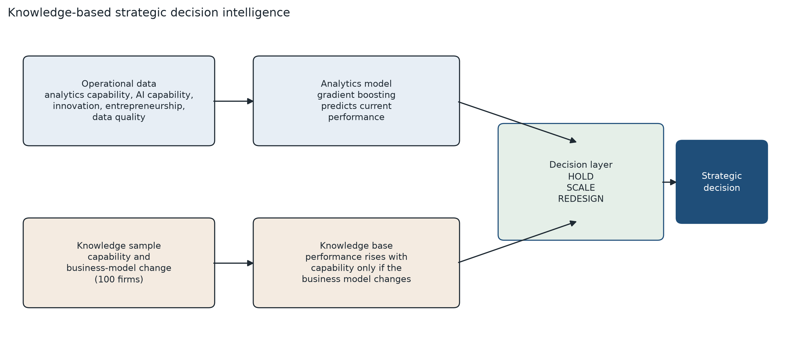
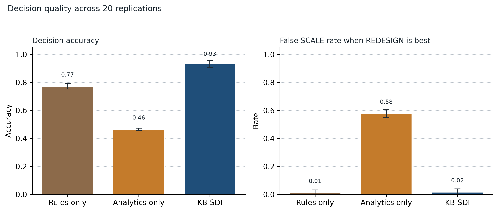

# A knowledge-based AI system for strategic decision intelligence: using data analytics to guide digital-transformation, innovation, and entrepreneurial decisions

**DBA 802. Data Analytics and Strategic Decision Intelligence**  
**Author:** Hema1712638

**Target journal:** *Knowledge-Based Systems* (short communication)

**Keywords:** strategic decision intelligence; data analytics; knowledge-based system; artificial intelligence; digital transformation; innovation; entrepreneurship; business model; firm performance

## Abstract

Strategic decision intelligence is the choice of an action, not a forecast of the current record. A firm can be strong in data analytics and still lose value if it scales a digital program before the business model changes. This short communication specifies KB-SDI, a knowledge-based artificial intelligence system that separates those judgments. Gradient boosting reads operational data on analytics capability, artificial intelligence capability, digital intensity, innovation, entrepreneurial orientation, and data quality, and estimates current performance. A knowledge base fit on 100 firms, the only records in which business-model change is assessed, supplies the mechanism: capability raises performance only when the business model changes. The decision layer compares a reservation value, the value of scaling, and the value of a redesign, and returns HOLD, SCALE, or REDESIGN. Across 20 replications of 5,000 synthetic entrepreneurial firms, mean decision accuracy was 0.931 for KB-SDI, 0.772 for the knowledge rule alone, and 0.465 for analytics alone. Analytics alone selected SCALE in 0.578 of the cases where REDESIGN was the better action. Where capability was high and business-model change was low, mean observed performance was 0.390; analytics predicted 0.485 and KB-SDI predicted 0.385, with no false SCALE decision on that slice. The firms are synthetic. The knowledge constraint is what makes the analytics usable for the strategic decision.

## 1. Introduction

Data analytics supports a strategic decision only when the score changes the action [1]. Leaders of entrepreneurial firms do not face a single invest-or-wait choice. They also decide whether the business model has to change before a digital or innovation program is scaled. Dynamic capabilities describe that sequence as sensing, seizing, and transforming [2,3]. Digital transformation is the renewal process through which those capabilities are rebuilt [4].

Analytics-capability research shows that data and artificial intelligence resources are associated with performance [5–7]. A model trained on the operational record estimates that association as it stands. It does not estimate performance as it would be if the business model changed, and business-model change is the condition under which the capability creates value [3,8]. The condition is also missing from most warehouses. Capability, innovation, and entrepreneurial orientation are stored as features. The strategic assessment of the business model is not.

A knowledge base can hold that mechanism while a learning model holds the regularities the mechanism does not state [9]. KB-SDI uses the division. Gradient boosting [10] predicts current performance from operational data. A four-parameter knowledge base, fit on firms where business-model change is assessed, adjusts the prediction and prices a redesign. The output is HOLD, SCALE, or REDESIGN. The firms below are synthetic, so the correct action is known and is not visible to the system. Analytics alone still selects SCALE when the value-maximizing action is to change the business model first.

## 2. System

Each firm has a data-analytics capability \(dac\) and an artificial intelligence capability \(aic\). The capability index used by the knowledge base is

\[
c = 0.55\,dac + 0.45\,aic.
\]

Operational features \(x\) are \(dac\), \(aic\), digital-transformation intensity, innovation intensity, entrepreneurial orientation, data quality, size, and age. Business-model change \(bmc \in [0,1]\) is observed in a knowledge sample and at decision time. It is not a column in the operational training matrix.

### 2.1 Knowledge base

On the knowledge sample the system estimates

\[
y = b_0 + b_c c + b_b\,bmc + b_{cb}\,c\cdot bmc + \varepsilon
\]

by least squares. The strategic content of the base is the marginal effect of a business-model change,

\[
\frac{\partial y}{\partial bmc} = b_b + b_{cb}\,c.
\]

The effect increases with capability. A high capability score does not, by itself, justify a high performance estimate.

### 2.2 Analytics model and fusion

Let \(g(x)\) be a gradient-boosting regression of observed performance on \(x\), trained only on the operational rows [10]. Because those rows omit \(bmc\), \(g(x)\) estimates performance at the sample’s average business model. For a firm whose assessed business-model change is \(bmc\), and whose knowledge-sample mean is \(\bar{bmc}\),

\[
\hat{y}(bmc) = g(x) + (b_b + b_{cb} c)\,(bmc - \bar{bmc}).
\]

A redesign is represented as a lift of business-model change to a target \(bmc' = \max(bmc, 0.82)\), which is a parameter of the knowledge base rather than a fitted prediction. The counterfactual performance is \(\hat{y}(bmc')\).

### 2.3 Decision layer

The three actions are valued as

\[
\begin{aligned}
V_{\text{HOLD}} &= 0.42,\\
V_{\text{SCALE}} &= \hat{y}(bmc) - 0.05,\\
V_{\text{REDESIGN}} &= \hat{y}(bmc') - 0.11.
\end{aligned}
\]

The system returns \(\arg\max\{V_{\text{HOLD}}, V_{\text{SCALE}}, V_{\text{REDESIGN}}\}\). The reservation value 0.42 is the payoff of leaving the program unchanged. Scaling costs 0.05 of a performance unit. Redesign costs 0.11, because changing the business model is the more expensive action. Both costs are decision parameters, and Section 4 varies the reservation value.

Two baselines use the same costs. **Rules-only** replaces \(g(x)\) with the knowledge equation, so innovation, entrepreneurial orientation, and data quality never enter. **Analytics-only** uses \(g(x)\) as both the current value and the counterfactual. Its redesign payoff is then its scale payoff minus 0.06, so it never selects REDESIGN. That is the decision policy of a system with no business-model action, not an extra constraint added after the fact.

## 3. Computational experiment

Five thousand firms are drawn independently in each replication. Capabilities and the operational features are beta or uniform variates on \([0,1]\), except size, which is standard normal. Business-model change is an independent Beta(1.7, 2.0) draw. It is independent of the operational features so that innovation and entrepreneurial orientation cannot stand in for it.

Expected performance, which no system observes, is

\[
\begin{aligned}
\mu ={}& 0.02 + 0.06c + 0.04\,bmc + 0.62\,c\cdot bmc + 0.10\,inn + 0.08\,eo\\
&+ 0.06\,dti + \frac{0.20}{1+\exp[-10(dq-0.55)]} + 0.05\,dac\cdot inn + 0.01\,z,
\end{aligned}
\]

where \(z\) is size clipped to \([-2,2]\). Observed performance is \(\mu\) plus Gaussian noise with standard deviation 0.04, clipped to \([0,1]\). The oracle action maximizes the same three payoffs, with \(\mu\) and the counterfactual \(\mu(bmc')\) in place of the estimates. Correctness is therefore known, and it is not defined by copying the knowledge rule.

Each replication holds out 28 percent of firms, stratified on the oracle action. Of the remainder, 100 firms are the knowledge sample and the rest train \(g(x)\). Twenty replications use seeds 802 through 821. The reported interaction in the data-generating process is 0.62. The system does not receive that number. It estimates \(b_{cb}\) on the knowledge sample.

The slice used in Table 2 is the test firms with \(c \ge 0.55\) and \(bmc \le 0.40\) (mean \(n = 231\) per replication). These are the firms the introduction is about: the analytics score is high, and the business model has not moved. Decision quality is accuracy, macro-F1, mean regret against the oracle payoff, root mean squared error of the current-performance estimate, the share of true REDESIGN cases given SCALE, and REDESIGN recall.

## 4. Results

Table 1 and Figure 2 give the twenty-replication means. KB-SDI accuracy is 0.931 (SD 0.025). Rules-only accuracy is 0.772 (SD 0.019). Analytics-only accuracy is 0.465 (SD 0.009). KB-SDI is more accurate than both baselines in all 20 replications. The mean accuracy gap is 0.160 (SD 0.017) against the rule and 0.466 (SD 0.029) against analytics. Mean regret falls from 0.048 under analytics, and 0.011 under the rule, to 0.001 under KB-SDI.

The error that matters for the strategic claim is a SCALE decision when REDESIGN is the oracle action. Analytics-only makes that error in 0.578 of true REDESIGN cases and never recalls REDESIGN, because it has no redesign action. KB-SDI makes it in 0.016 of those cases and recalls 0.923 of them. Rules-only also avoids false SCALE (0.011) but recalls only 0.815 of REDESIGN cases and cannot use data quality, innovation, or entrepreneurial orientation. Fusion is what raises accuracy. The knowledge base is what removes the false scale.

The estimated interaction averages 0.655 (SD 0.216) against the process value 0.62. At 100 knowledge firms the coefficient is noisy. The decision does not require a precise coefficient. It requires the sign and the dependence on capability.

Table 2 isolates high capability and low business-model change. Mean observed performance on the slice is 0.390 (SD 0.006). Analytics-only predicts 0.485 (SD 0.007), issues SCALE on 0.601 of the slice cases that should be redesigned, and never recommends REDESIGN. Its slice regret is 0.136. KB-SDI predicts 0.385 (SD 0.021), which sits on the observed mean, issues no false SCALE on the slice, and recalls 0.960 of the redesigns. Rules-only is also clean on this slice, with redesign recall 1.000, because the slice is exactly the case the mechanism was written for. Its overall accuracy in Table 1 shows the cost of ignoring the operational record.

The ranking holds on ten further replications. At a knowledge sample of 40 firms, KB-SDI accuracy is 0.875 (SD 0.075), against 0.754 (SD 0.039) for rules-only. At 200 firms it is 0.933 (SD 0.028). At reservation values 0.38 and 0.46 it is 0.933 (SD 0.026) and 0.912 (SD 0.037), and it remains first.

**Figure 1.** KB-SDI reads operational data with gradient boosting and a 100-firm knowledge sample in which business-model change is assessed. The decision layer returns HOLD, SCALE, or REDESIGN.

**Figure 2.** Mean decision accuracy and false SCALE rate over 20 replications. Error bars are one standard deviation. The false SCALE rate is the share of oracle REDESIGN cases labeled SCALE.

**Table 1.** Decision quality on the held-out firms. Cells are the mean across 20 replications, with the standard deviation in parentheses. False SCALE is computed on oracle REDESIGN cases. Regret is the oracle payoff minus the payoff of the chosen action.

| System | Accuracy | Macro-F1 | Regret | RMSE | False SCALE | REDESIGN recall |
|---|---:|---:|---:|---:|---:|---:|
| Rules-only | 0.772 (0.019) | 0.775 (0.022) | 0.011 (0.001) | 0.088 (0.002) | 0.011 (0.021) | 0.815 (0.073) |
| Analytics-only | 0.465 (0.009) | 0.342 (0.009) | 0.048 (0.002) | 0.094 (0.002) | 0.578 (0.028) | 0.000 (0.000) |
| KB-SDI | 0.931 (0.025) | 0.928 (0.027) | 0.001 (0.001) | 0.047 (0.002) | 0.016 (0.024) | 0.923 (0.071) |

**Table 2.** Firms with capability at least 0.55 and business-model change at most 0.40. Mean slice size is 231 test firms. False SCALE is computed on the slice cases whose oracle action is REDESIGN.

| System | REDESIGN recall | False SCALE | Regret |
|---|---:|---:|---:|
| Rules-only | 1.000 (0.000) | 0.000 (0.000) | 0.002 (0.001) |
| Analytics-only | 0.000 (0.000) | 0.601 (0.035) | 0.136 (0.007) |
| KB-SDI | 0.960 (0.044) | 0.000 (0.000) | 0.001 (0.001) |

## 5. Conclusion

KB-SDI is a strategic decision system for digital transformation, innovation, and entrepreneurship. Data analytics estimates where the firm is. The knowledge base estimates whether a business-model change is required before that position is scaled. On the synthetic population defined in Section 3, separating the two cuts the false SCALE rate from 0.578 to 0.016 and raises decision accuracy from 0.465 to 0.931.

The study does not use records from operating firms. The reservation value, the action costs, and the redesign target of 0.82 are parameters. A deployment needs a knowledge sample in which managers assess business-model change, and it needs those parameters set from the firm’s own payoffs. What the experiment isolates, and what a field study cannot randomize as cleanly, is the cost of treating a performance forecast as a strategic decision.

Every number in Tables 1 and 2 is reproduced by `kb_sdi.py`.

## References

[1] H. Chen, R.H.L. Chiang, V.C. Storey, Business intelligence and analytics: From big data to big impact, MIS Quarterly 36 (2012) 1165–1188.

[2] D.J. Teece, Explicating dynamic capabilities: The nature and microfoundations of (sustainable) enterprise performance, Strategic Management Journal 28 (2007) 1319–1350.

[3] D.J. Teece, Business models and dynamic capabilities, Long Range Planning 51 (2018) 40–49.

[4] K.S.R. Warner, M. Wäger, Building dynamic capabilities for digital transformation: An ongoing process of strategic renewal, Long Range Planning 52 (2019) 326–349.

[5] S.F. Wamba, A. Gunasekaran, S. Akter, S.J. Ren, R. Dubey, S.J. Childe, Big data analytics and firm performance: Effects of dynamic capabilities, Journal of Business Research 70 (2017) 356–365.

[6] P. Mikalef, J. Krogstie, I.O. Pappas, P. Pavlou, Exploring the relationship between big data analytics capability and competitive performance: The mediating roles of dynamic and operational capabilities, Information & Management 57 (2020) 103169.

[7] M. Gupta, J.F. George, Toward the development of a big data analytics capability, Information & Management 53 (2016) 1049–1064.

[8] N.J. Foss, T. Saebi, Fifteen years of research on business model innovation: How far have we come, and where should we go?, Journal of Management 43 (2017) 200–227.

[9] R. Studer, V.R. Benjamins, D. Fensel, Knowledge engineering: Principles and methods, Data & Knowledge Engineering 25 (1998) 161–197.

[10] J.H. Friedman, Greedy function approximation: A gradient boosting machine, Annals of Statistics 29 (2001) 1189–1232.
